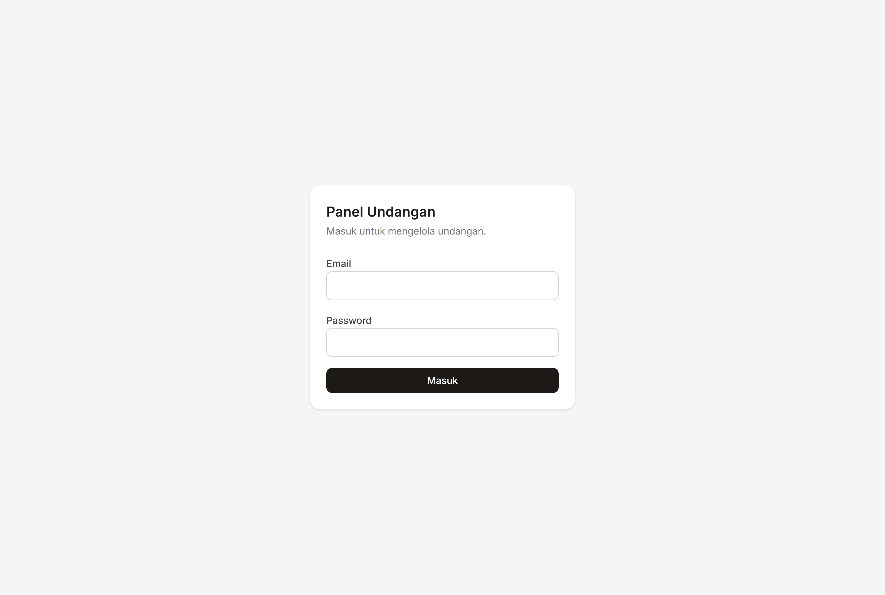
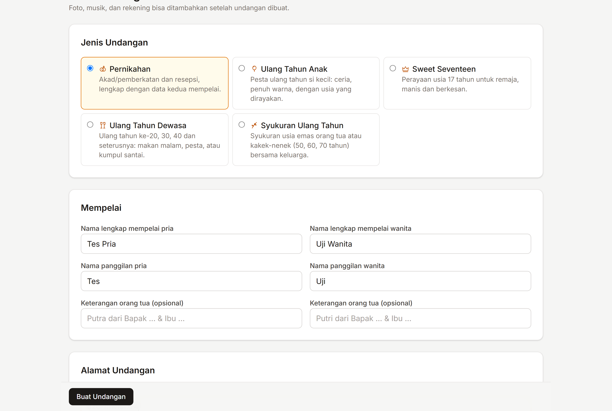
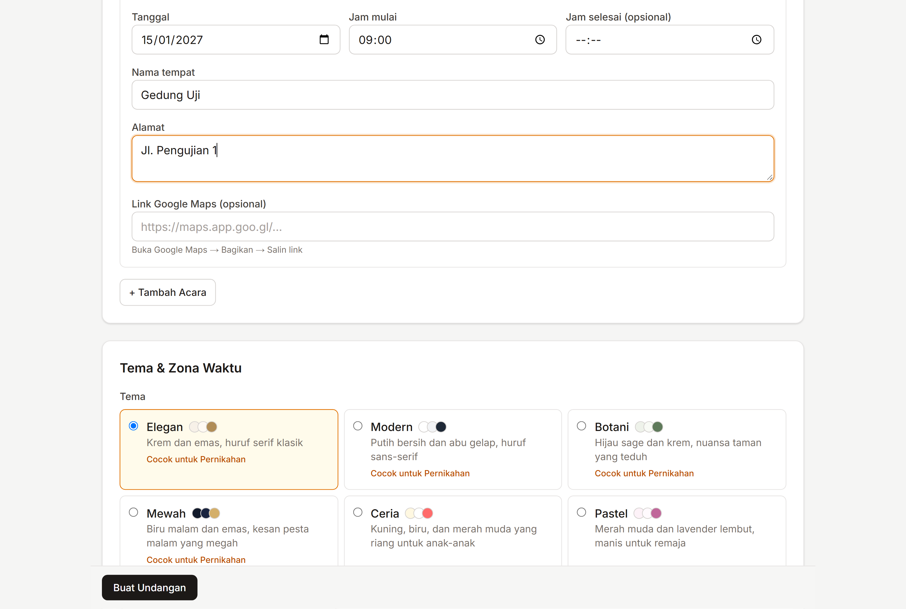
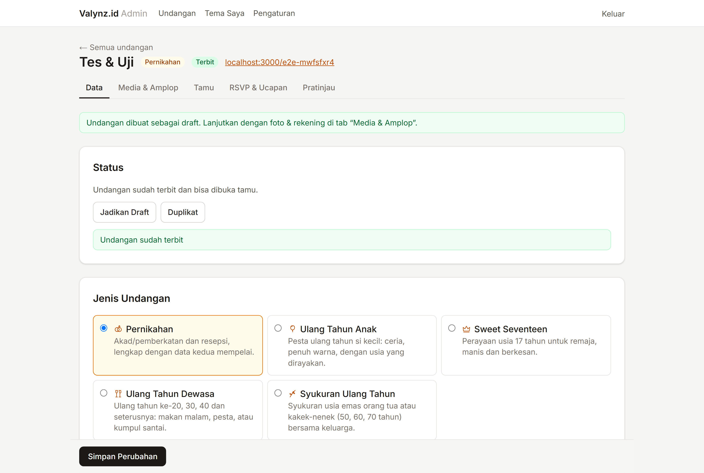
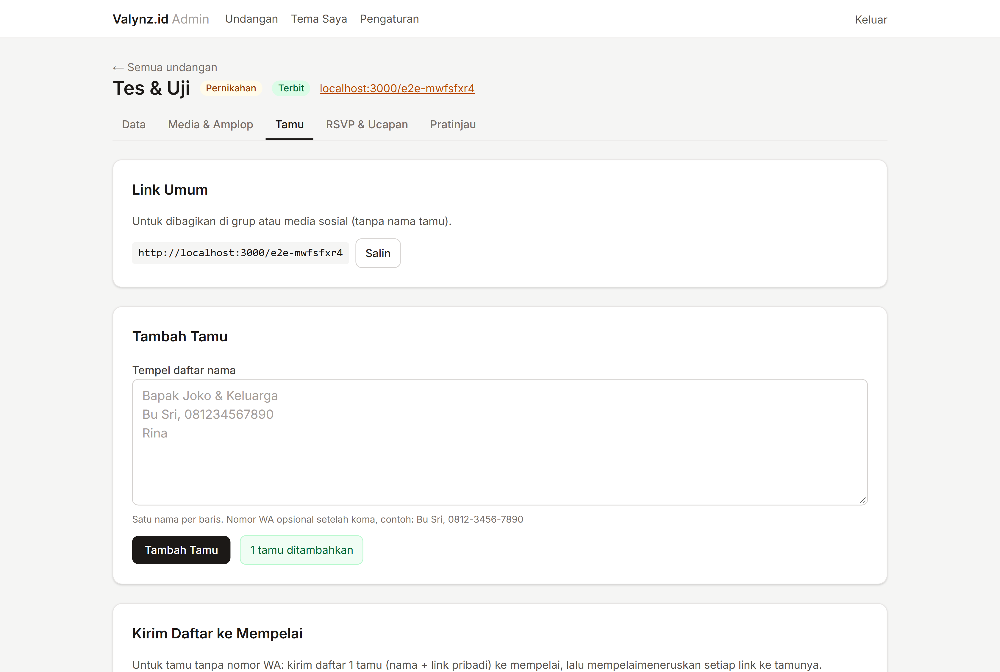
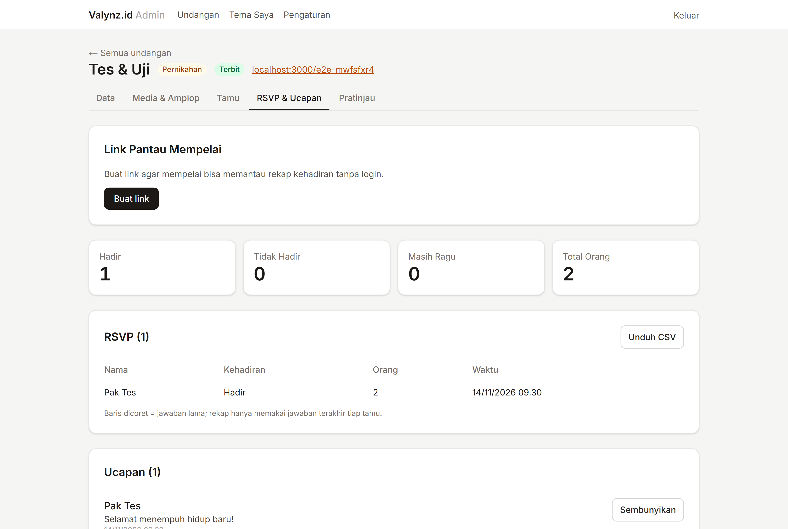
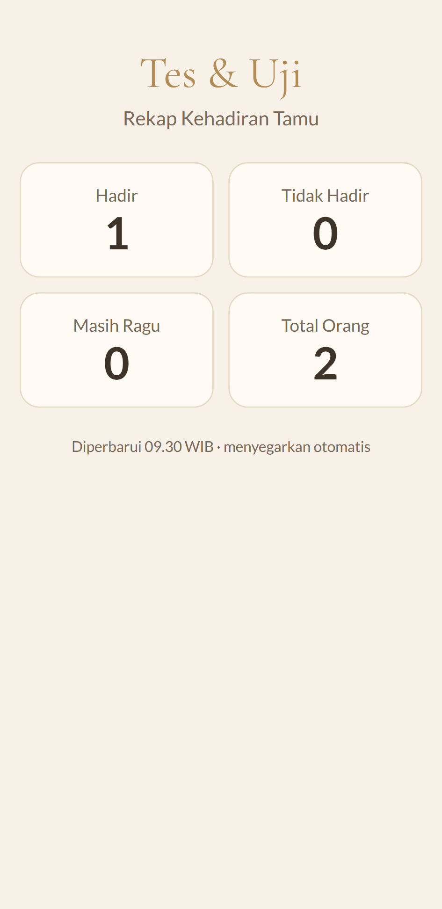

# Panduan Menjalankan & Online-kan Undangan Digital

Panduan ini untuk pemilik bisnis tanpa latar belakang coding. Ikuti urutannya dari atas ke bawah.
Semua layanan di sini **gratis**.

---

## 1. Siapkan database (Supabase)

1. Buka <https://supabase.com>, lalu klik **Start your project** → **Continue with GitHub**.
2. Klik **New project**, lalu isi:
   - **Name:** `undangan-digital`
   - **Database Password:** buat password kuat lalu **catat** (dipakai di langkah 5).
   - **Region:** `Southeast Asia (Singapore)`

   Klik **Create new project** dan tunggu ±2 menit.
3. Menu kiri **Authentication** → **Sign In / Providers** → matikan **Allow new users to sign up** →
   **Save**. Dengan begitu, tidak ada orang asing yang bisa mendaftar.
4. Menu **Authentication** → **Users** → **Add user** → **Create new user**:
   - Isi email & password Anda, centang **Auto Confirm User**, lalu **Create user**.
   - (Opsional, untuk tes otomatis) buat user kedua, misalnya `e2e@undangan.test`.
5. Buka file `.env.local` di folder proyek (salin dari `.env.example` bila belum ada) lalu isi:

   | Nama | Diambil dari |
   |---|---|
   | `NEXT_PUBLIC_SUPABASE_URL` | **Project Settings → API Keys / Data API**: *Project URL* |
   | `NEXT_PUBLIC_SUPABASE_ANON_KEY` | **Project Settings → API Keys**: kunci *anon* / *publishable* |
   | `SUPABASE_SERVICE_ROLE_KEY` | **Project Settings → API Keys**: kunci *service_role* / *secret* |
   | `SUPABASE_DB_URL` | Tombol **Connect** (atas) → **Session pooler** → salin URI, ganti `[YOUR-PASSWORD]` |
   | `NEXT_PUBLIC_SITE_URL` | Biarkan `http://localhost:3000` untuk sekarang |

   > ⚠️ Kunci *service_role* sangat rahasia. Jangan dibagikan ke siapa pun, jangan ditempel di chat,
   > dan **jangan** dimasukkan ke Vercel.

6. Buka terminal di folder proyek, lalu jalankan:

   ```bash
   npm install
   npm run db:push                              # membuat tabel & pengaturan keamanan
   npm run make-admin -- emailanda@contoh.com   # menjadikan akun Anda admin
   npm run db:seed                              # (opsional) undangan contoh /demo-budi-ani
   ```

7. Coba di komputer sendiri: `npm run dev`, lalu buka <http://localhost:3000/admin>.

---

## 2. Simpan kode di GitHub

1. Masuk ke <https://github.com> dengan akun **randysilvio**.
2. Klik **+** (kanan atas) → **New repository**:
   - **Repository name:** `undangan-digital`
   - Pilih **Private**.
   - Jangan centang README / .gitignore / license.
   - Klik **Create repository**.
3. Di terminal folder proyek:

   ```bash
   git checkout main
   git merge feat/tahap-1
   git remote add origin https://github.com/randysilvio/undangan-digital.git
   git push -u origin main
   ```

   Bila diminta login, ikuti jendela login GitHub yang muncul.

---

## 3. Online-kan di Vercel

1. Buka <https://vercel.com> → **Sign Up** → **Continue with GitHub** (akun randysilvio). Pilih paket **Hobby** (gratis).
2. Klik **Add New…** → **Project** → pilih repo `undangan-digital` → **Import**.
3. Buka bagian **Environment Variables** dan tambahkan **hanya** 2 variabel berikut:
   - `NEXT_PUBLIC_SUPABASE_URL`
   - `NEXT_PUBLIC_SUPABASE_ANON_KEY`

   `NEXT_PUBLIC_SITE_URL` **tidak perlu** diisi: link tamu & link pantau otomatis memakai alamat
   produksi dari Vercel. Jangan menebak alamat seperti `undangan-digital.vercel.app`, karena alamat
   itu bisa saja milik orang lain.
   Jangan klik **Add** pada integrasi Supabase yang ditawarkan Vercel.
4. Klik **Deploy** dan tunggu ±2 menit.
5. Klik **Continue to Project**. Alamat web Anda ada di bagian **Domains** (misalnya
   `https://undangan-digital-xxxx.vercel.app`).
6. Buka `https://alamat-anda.vercel.app/admin` dan masuk dengan akun admin.

Setiap kali kode baru di-push ke GitHub, Vercel otomatis memperbarui web.

---

## 4. Membuat undangan pertama

1. **Masuk** di `/admin`.

   

2. Klik **+ Buat Undangan**, lalu isi nama mempelai. **Alamat (slug)** akan terisi otomatis dan bisa
   diubah, misalnya `budi-ani`.

   

3. Isi **Acara**: tanggal, jam, tempat, alamat, dan link Google Maps. Pilih **Tema** dan **Zona waktu**
   (WIB/WITA/WIT, sesuai lokasi acara). Lalu klik **Buat Undangan**.

   

4. Buka tab **Media & Amplop** untuk mengunggah foto sampul, foto mempelai, galeri (maks. 30 foto),
   musik MP3 (maks. 10 MB), dan rekening amplop digital.
5. Cek hasilnya di tab **Pratinjau**. Bila sudah benar, kembali ke tab **Data**, lalu klik **Terbitkan**.

   

6. Buka tab **Tamu**, tempel daftar nama (satu per baris; nomor WA boleh setelah koma), lalu klik
   **Tambah Tamu**. Setiap tamu punya tombol:
   - **Salin link**: link pribadi berisi nama tamu.
   - **Kirim WA**: membuka WhatsApp dengan pesan undangan yang sudah jadi.

   

7. Pantau konfirmasi di tab **RSVP & Ucapan**:
   - Klik **Unduh CSV** untuk membuka data di Excel.
   - Ucapan yang tidak pantas bisa **Disembunyikan**.

   

8. **Link pantau untuk mempelai.** Mempelai bisa melihat rekap kehadiran sendiri tanpa login:
   - Di tab **RSVP & Ucapan**, pada kotak **Link Pantau Mempelai**, klik **Buat link**.
   - Klik **Kirim WA** lalu pilih kontak mempelai, atau **Salin** untuk dikirim lewat jalur lain.
     Satu link dipakai bersama kedua mempelai.
   - Mempelai hanya melihat angka (Hadir, Tidak Hadir, Masih Ragu, Total Orang). Nama dan nomor tamu
     tidak ditampilkan. Angka menyegarkan sendiri tiap menit selama halaman dibuka.
   - Bila link tersebar ke orang lain, klik **Buat ulang**: link lama langsung mati, lalu kirim link
     baru ke mempelai. **Matikan** menutup akses sepenuhnya.

   

**Tips:**
- Tombol **Duplikat** menyalin undangan (tanpa tamu & RSVP). Ini memudahkan membuat undangan klien
  berikutnya dengan susunan yang sama.
- Tamu yang menjawab RSVP dua kali hanya dihitung jawaban terakhirnya.

---

## 5. Tema Saya dan Pengaturan Situs

**Tema Saya** (menu atas panel admin) membuat tema dengan warna, huruf, dan gambar hiasan sendiri:

1. **Tema Saya → + Buat Tema**: isi nama, pilih tema dasar, atur warna dan huruf, lalu **Buat Tema**.
2. Di halaman tema, unggah gambar ke slot yang diinginkan (latar sampul, bingkai, hiasan sudut, tekstur,
   hiasan atas judul, ornamen, partikel, latar penutup). Desain di Canva/Photoshop **tanpa teks**, simpan
   sebagai PNG transparan. Slot yang kosong memakai tampilan tema dasar. Pratinjau HP di kanan langsung
   diperbarui.
3. Centang **Tampilkan di galeri publik** agar tema muncul di halaman depan dan halaman contoh.
4. Pilih tema di formulir undangan, bagian **Tema kustom**.

Mengubah tema langsung mengubah semua undangan yang memakainya. Untuk mencoba variasi, pakai
**Duplikat Tema**. Tema yang masih dipakai undangan tidak bisa dihapus.

**Pengaturan** mengisi nomor WhatsApp, Instagram, email, dan paket harga di halaman depan. Kolom yang
kosong tidak ditampilkan. Pilihan "Undangan digital oleh Valynz.id" menambahkan tulisan kecil di akhir
setiap undangan (bawaan: mati).

## 6. Domain sendiri (valynz.id)

1. Beli domain, misalnya `valynz.id`, di registrar mana pun.
2. Di Vercel, buka **Project → Settings → Domains** → **Add** → masukkan domain. Ikuti petunjuk
   pengaturan DNS yang ditampilkan.
3. Jadikan domain itu domain utama (production). Link tamu, sitemap, dan gambar pratinjau otomatis
   memakainya setelah **Redeploy**. Bila perlu, isi `NEXT_PUBLIC_SITE_URL` dengan `https://valynz.id`.

Link lama berakhiran `.vercel.app` tetap bisa dibuka.

---

## Bila ada masalah

| Gejala | Solusi |
|---|---|
| `Isi dulu di .env.local: ...` | Ada variabel yang belum diisi di `.env.local`. |
| Login: "Akun ini tidak punya akses admin" | Jalankan `npm run make-admin -- emailanda@contoh.com`. |
| Undangan "tidak ditemukan" | Pastikan statusnya **Terbit** dan alamatnya benar. |
| Link tamu mengarah ke `localhost` | Ubah `NEXT_PUBLIC_SITE_URL` di Vercel, lalu **Redeploy**. |
| Foto ditolak | Gunakan JPG/PNG. Foto dari HP otomatis dikecilkan sebelum diunggah. |
| Semua undangan menampilkan "Maaf, terjadi gangguan" | Proyek Supabase gratis **dijeda otomatis** bila 7 hari tidak dipakai. Buka dashboard Supabase → proyek Anda → **Restore project**, tunggu ±2 menit. |
| Penyimpanan hampir penuh (1 GB gratis) | Foto/musik yang diganti tidak otomatis dihapus. Hapus file lama lewat Supabase → **Storage** → `media`, atau upgrade paket. |
